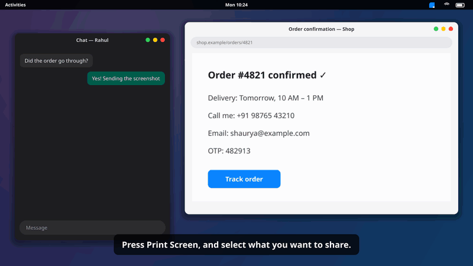
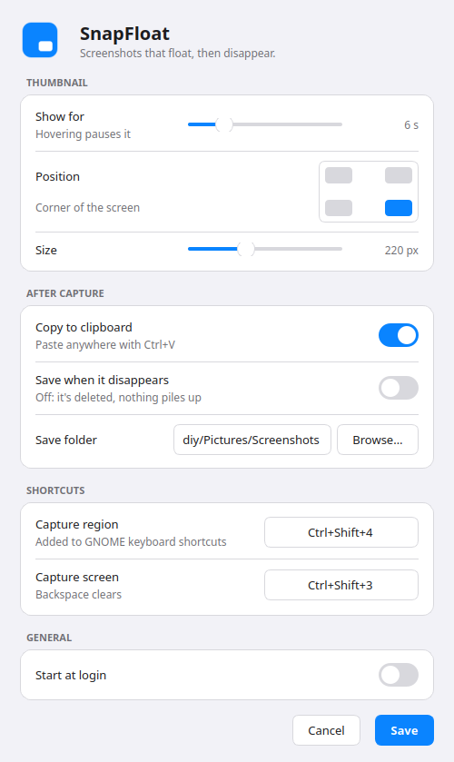

# SnapFloat

**The macOS screenshot thumbnail, for Linux and Windows.** Free and open source.

Take a screenshot and a thumbnail floats in the corner of your screen. Drag it straight into WhatsApp, Slack, Discord, Gmail, ChatGPT, or any other app.
Nothing is saved to your Screenshots folder, so there's no pile of old screenshots to clean up later.

<p align="center"></p>
<p align="center"><a href="docs/snapfloat-demo.mp4">▶ Watch the 70-second tour with voiceover (MP4, 1080p, English captions)</a> · <a href="docs/snapfloat-demo.srt">captions (.srt)</a></p>

---

## Contents
- [Why](#why)
- [Features](#features)
- [Beyond macOS](#beyond-macos)
- [Install](#install)
- [How to use](#how-to-use)
- [Markup](#markup)
- [Settings](#settings)
- [Privacy: where screenshots go](#privacy-where-screenshots-go)
- [Platform notes](#platform-notes)
- [Troubleshooting](#troubleshooting)
- [Uninstall](#uninstall)
- [Build from source](#build-from-source)
- [Project structure](#project-structure)
- [Contributing](#contributing)
- [Roadmap](#roadmap)
- [License](#license)

## Why
Most screenshots are sent once and never looked at again. On Linux and Windows every one of them is saved as a file, so you end up deleting hundreds by hand.
macOS fixed this years ago with its floating thumbnail. SnapFloat brings the same workflow to Linux and Windows.

## Features
- **Floating thumbnail**, smooth slide-in, in the corner you choose
- **Drag & drop** into any app (it's also copied to the clipboard, so `Ctrl+V` works too)
- **Auto-dismiss** after N seconds, with a countdown bar; hovering pauses it, `0` keeps it until you close it
- **Quick markup:** click the thumbnail to add arrows, boxes, ellipses, pen, highlighter, text, spotlight, crop, and **blur to hide phone numbers, emails or OTPs** before you send
- **Flick to dismiss:** throw the thumbnail toward the screen edge, like on a Mac
- **Recent screenshots** in the tray menu: grab one again after its thumbnail is gone
- **Delayed capture** (3, 5 or 10 seconds) with a countdown ring, for menus and hover states
- **Smaller files** (optional): drag a compact JPG instead of a full-size PNG for faster chat uploads
- **Stacks** several shots; the newest sits in the corner, and the rest glide into place
- **Save on timeout** (optional) to a folder of your choice
- **Custom shortcuts**, start at login, tray icon, shutter sound and screen flash
- **Windows bonus:** optionally show a thumbnail for `Win+Shift+S` / `PrtSc` captures too
- **Simple:** one Python file, no telemetry, no network access (about 140 MB of RAM, mostly the Qt toolkit)

## Beyond macOS
Things SnapFloat does that the macOS screenshot thumbnail doesn't:

| Feature | How |
|---|---|
| **Hide private info, one click** | In markup, the 👁 button finds emails, phone numbers, OTPs and card/account numbers and marks them. Click any you want to keep visible, `Enter` blurs the rest |
| **Copy text from a screenshot** | Right-click → *Copy text* for all of it, or in markup drag a box with the `X` tool to copy just that part (OCR, in the languages you pick in Settings) |
| **Read QR codes** | Right-click → *Read QR code*: the link or text in a QR code or barcode is copied |
| **Magnifier** | Markup tool `M`: a 2× zoom bubble for small details (it never reveals what you blurred) |
| **Blur** | A real redaction tool. Mac markup has no blur |
| **Numbered steps** | Markup tool `N`: click to drop 1, 2, 3… badges for how-to guides |
| **Spotlight** | Markup tool `S`: darken everything except the part that matters |
| **Beautify** | Right-click → *Beautify*: gradient background, rounded corners and shadow, ready for social media |
| **Combine** | Right-click → *Combine all into one*: several screenshots become one image to send |
| **Drag all at once** | Hold `Shift` while dragging: every visible screenshot goes in one drop |
| **Recent** | Tray → *Recent*: grab a screenshot again after its thumbnail is gone |
| **Smaller files** | Send a compact JPG instead of a huge PNG |
| **One-key capture** | `PrtSc` for a region, `Shift+PrtSc` for the whole screen |

*Hide private info* and *Copy text* use the free [Tesseract](https://github.com/tesseract-ocr/tesseract) OCR engine. `install.sh` installs it on Ubuntu/Debian; on Windows install it with `winget install UB-Mannheim.TesseractOCR`. Without it those two options are greyed out. Everything runs on your computer and nothing is uploaded.

## Install

### Windows
**With [Scoop](https://scoop.sh):**
```powershell
scoop bucket add snapfloat https://github.com/shaurya-8055/scoop-bucket
scoop install snapfloat
```
To update: quit SnapFloat from the tray first (Scoop won't replace a running app), then `scoop update snapfloat`.
**Or by hand:**
1. Download `SnapFloat.exe` from [Releases](https://github.com/shaurya-8055/snapfloat/releases).
2. Run it. It sits in the system tray (click `^` near the clock if you don't see it).
3. Press `Ctrl+Shift+4` and select an area.

> Windows SmartScreen may warn about an unknown publisher because the exe isn't code-signed. Click **More info → Run anyway**, or [build it yourself](#build-from-source).

### Linux: AppImage (any distro, no install)
1. Download `SnapFloat-x86_64.AppImage` from [Releases](https://github.com/shaurya-8055/snapfloat/releases).
2. Make it executable and run it:
   ```sh
   chmod +x SnapFloat-x86_64.AppImage && ./SnapFloat-x86_64.AppImage
   ```
3. On GNOME, **log out and back in once**: SnapFloat installs its small GNOME extension on first run, and GNOME loads it at login.

It starts at login from then on. Also install:
- **Tesseract**, for *Copy text* and *Hide private info*: `sudo apt install tesseract-ocr` / `sudo dnf install tesseract`
- **wl-clipboard**, so *Copy to clipboard* works on Wayland: `sudo apt install wl-clipboard` / `sudo dnf install wl-clipboard`

If your system lacks FUSE, run it with `--appimage-extract-and-run`.

### Ubuntu / Debian (GNOME), from source
```sh
git clone https://github.com/shaurya-8055/snapfloat
cd snapfloat
./install.sh
```
Then **log out and back in once**. This activates the small GNOME Shell extension that keeps thumbnails in the corner (see [Platform notes](#platform-notes)).
SnapFloat registers its shortcuts in *Settings → Keyboard → Custom Shortcuts* when it starts. Run `./install.sh` again to update.

### Other Linux desktops (KDE, XFCE, …)
The [AppImage](#linux-appimage-any-distro-no-install) is the easiest way. Then bind these commands in your desktop's keyboard settings:
| Command | Suggested key |
|---|---|
| `/path/to/SnapFloat-x86_64.AppImage --region` | `PrtSc` or `Ctrl+Shift+4` |
| `/path/to/SnapFloat-x86_64.AppImage --screen` | `Shift+PrtSc` or `Ctrl+Shift+3` |

(Running from source instead: see [Build from source](#build-from-source), then use `/path/to/.venv/bin/python /path/to/snapfloat.py --region`.)

### Requirements
- Python 3.9+ (not needed for the Windows exe)
- Linux: an X11 session, or a Wayland session with `xdg-desktop-portal` (default on Ubuntu, Fedora, and most others)
- Optional: `tesseract-ocr` for *Copy text* and *Hide private info* (`install.sh` adds it)

## How to use

### Shortcuts (default; change them in Settings)
| Keys | Action |
|---|---|
| `PrtSc` | Capture a region (one key) |
| `Shift+PrtSc` | Capture the whole screen |
| `Ctrl+Shift+4` / `Ctrl+Shift+3` | Same, Mac-style; work alongside |
| Click the tray icon | Capture a region |
| `Esc` / right-click | Cancel a region selection (Windows/X11) |

### The thumbnail
| Do this | And this happens |
|---|---|
| Drag it into an app | The screenshot is sent there, and the thumbnail goes away |
| `Shift` + drag | Sends **all** visible screenshots at once |
| `Ctrl+V` anywhere | Pastes the screenshot (it's already on your clipboard) |
| Click | Opens [markup](#markup) |
| Flick toward the screen edge | Dismisses it (a short flick springs back) |
| Hover | Pauses the countdown |
| Click the **✕** | Closes it (still available under *Recent*) |
| Right-click | Mark up · Copy · Copy text · Read QR code · Beautify · Combine all · Open in viewer · Save · Save As · Pin · Close |

### Tray menu
| Item | What it does |
|---|---|
| Capture region / Capture screen | Same as the shortcuts |
| Capture after… | 3, 5 or 10 second countdown, then a region capture. Click the ring to cancel |
| Recent | The last 10 screenshots of this session. Click one to bring its thumbnail back and drag it again |

## Markup
Click a thumbnail to open the editor. **Done** updates the thumbnail, its file and the clipboard, so you can drag the edited version straight away.

| Tool | Key | Use it for |
|---|---|---|
| Select | `V` | Click a mark to select it: drag to move it, `Delete` removes it, `[` `]` resize it |
| Arrow | `A` | Point at something |
| Box | `R` | Frame an area |
| Ellipse | `E` | Circle something |
| Pen | `P` | Draw freehand |
| Highlighter | `H` | Mark text, like a marker pen |
| Text | `T` | Click, type, press `Enter` (`Shift+Enter` for a new line, `Esc` drops it) |
| Numbered steps | `N` | Click to place 1, 2, 3… badges |
| Magnifier | `M` | Drag out from the centre of a small detail: a 2× bubble appears beside it |
| Spotlight | `S` | Drag over what matters: everything else darkens (several spotlights combine; arrows and text stay bright) |
| Copy text from an area | `X` | Drag a box over some text: just that text is copied. Nothing is drawn on the screenshot |
| Blur | `B` | Drag over phone numbers, emails, OTPs or faces. Uses a coarse mosaic, so the text can't be recovered |
| Crop | `C` | Drag the area to keep |
| Colour picker | `I` | Click a pixel: its colour becomes your pen colour and its hex code is copied |

Toolbar buttons: **👁 Hide private info** (finds emails, phone numbers, OTPs, card numbers; click a box to leave it visible, `Enter` blurs the rest as one undo step) and **Copy text** (all of it; use the `X` tool for just a part).

`Ctrl+Z` undo · `Ctrl+Shift+Z` redo · `[` `]` smaller/bigger marks · `Enter` done · `Esc` cancel. Pick a colour from the swatches; line widths match what you see on screen.

### Command line
```sh
snapfloat              # start in the tray (or open Settings if it's already running)
snapfloat --region     # capture a region (starts the app if needed)
snapfloat --screen     # capture the whole screen
snapfloat --settings   # open Settings
snapfloat --quit       # quit
snapfloat --self-test  # check this install works: drawing, image formats, helper programs, OCR, QR (no window opens)
```

## Settings
Open from the tray icon → **Settings…**

<p align="center"></p>

| Setting | What it does | Default |
|---|---|---|
| Show for | Seconds the thumbnail stays; `0` = until you close it | 6 s |
| Position | Which screen corner | bottom-right |
| Size | Thumbnail size | 220 px |
| Copy to clipboard | Also put every shot on the clipboard | on |
| Send smaller files | Drag a JPG (max 1920 px) instead of the full PNG | off |
| Save when it disappears | Keep a copy in the save folder after timeout | off |
| Save folder | Where *Save* puts files | `~/Pictures/Screenshots` |
| Print Screen key | `PrtSc` = region, `Shift+PrtSc` = whole screen. Takes those keys over from GNOME (its `Alt+PrtSc` window shot stays) or from Windows' Snipping Tool; turning it off or uninstalling gives them back | on |
| Capture region / screen | Extra global shortcuts. Click the field and press keys; Backspace clears it | `Ctrl+Shift+4` / `Ctrl+Shift+3` |
| Start at login | Launch automatically, so the first shortcut after a reboot is instant | on |
| Shutter sound / Screen flash | (Windows/X11) Feedback when a shot is taken. On Wayland, GNOME already does both | on |
| Also catch copied images | (Windows/X11) Show a thumbnail for `Win+Shift+S`/`PrtSc` captures | off |
| Text languages | OCR languages for *Copy text* and *Hide private info*, joined with `+` (e.g. `eng+hin`). Add more with `sudo apt install tesseract-ocr-hin` | English |

Settings are stored in `~/.config/snapfloat/snapfloat.conf` (Linux) or the registry under `HKCU\Software\snapfloat` (Windows).

## Privacy: where screenshots go
- Screenshots are written to a private, owner-only folder: your session's runtime folder on Linux (`/run/user/<id>/snapfloat`, which other users can't see and which is cleared at logout) or `%TEMP%\snapfloat-<user>` on Windows.
- The last 10 stay there so *Recent* can bring them back; older ones are deleted as new ones arrive. All of them are deleted when SnapFloat quits.
- Nothing goes to your Screenshots folder unless you click **Save** or turn on *Save when it disappears*.
- SnapFloat makes no network connections.

## Platform notes

### Linux on Wayland (Ubuntu, Fedora, …)
Wayland is stricter than X11, which is the main reason a tool like this didn't exist before:
- **Capturing:** apps can't read the screen directly, so SnapFloat asks the desktop's own screenshot UI (via `xdg-desktop-portal`). That UI saves into `~/Pictures`, and SnapFloat immediately moves the file out to its temp folder.
- **Placement:** Wayland doesn't let apps position their windows or keep them on top. The bundled GNOME Shell extension (`gnome-extension/`) does that for SnapFloat's thumbnails. It touches only windows titled `snapfloat-thumb …`, and it also stops thumbnails from taking focus away from the app you're typing in. Without it, thumbnails still work but open wherever GNOME places them.
- **Shortcuts:** apps can't grab global keys, so SnapFloat registers GNOME custom shortcuts that run `snapfloat --region` / `--screen`.

**The `PrtSc` key** is SnapFloat's by default (Settings → *Print Screen key*). Region capture still opens GNOME's own screenshot UI; SnapFloat just keeps the result out of your Screenshots folder.

### Windows
- Shortcuts are real global hotkeys. If one is taken by another app, SnapFloat shows a tray message, so pick another.
- To stop Windows saving its own `Win+Shift+S` captures: Snipping Tool → Settings → turn off *Automatically save screenshots*.

## Troubleshooting
| Problem | Fix |
|---|---|
| Settings says the extension is out of date (after a GNOME upgrade) | Update SnapFloat (`git pull && ./install.sh`) and log out and back in |
| Thumbnail appears in the middle of the screen (GNOME) | Log out and back in once after installing. Check with `gnome-extensions info snapfloat@shaurya-8055.github.io` (should say `State: ACTIVE`, or `ENABLED` on GNOME 45) |
| Shortcut does nothing (GNOME) | Check *Settings → Keyboard → Custom Shortcuts* for "SnapFloat region". Another shortcut may use the same keys |
| `Ctrl+Shift+3` (full screen) does nothing on Wayland, but region capture works | GNOME needs permission for silent screenshots and can't ask a tray app. Re-run `./install.sh`, or run `gdbus call --session --dest org.freedesktop.impl.portal.PermissionStore --object-path /org/freedesktop/impl/portal/PermissionStore --method org.freedesktop.impl.portal.PermissionStore.SetPermission screenshot true screenshot snapfloat "['yes']"` |
| No tray icon (GNOME) | Needs the AppIndicator extension (enabled by default on Ubuntu; on Fedora install *AppIndicator and KStatusNotifierItem Support*) |
| Drag doesn't drop into an app | Paste with `Ctrl+V` instead, and [open an issue](https://github.com/shaurya-8055/snapfloat/issues) naming the app |
| `Could not load the Qt platform plugin "xcb"` | `sudo apt install libxcb-cursor0` |
| Windows: "Shortcut already used" | Choose different keys in Settings |

Debug logs: run `snapfloat` from a terminal. For drag & drop details: `QT_LOGGING_RULES="qt.qpa.xdnd.debug=true" snapfloat`.

## Uninstall
The easiest way on any system: **Settings → Uninstall…**. It removes the shortcuts, autostart entry, settings, GNOME extension and temporary screenshots, then quits. Screenshots you saved are not touched.

- **Linux, installed with `install.sh`:** `snapfloat --uninstall` (or `./install.sh --uninstall` from the cloned folder)
- **Linux, AppImage:** `./SnapFloat-x86_64.AppImage --uninstall`, then delete the file
- **Windows, Scoop:** `scoop uninstall snapfloat` (it runs SnapFloat's own uninstall first)
- **Windows, winget:** first *Settings → Uninstall…* (winget can't run SnapFloat's cleanup itself), then `winget uninstall ShauryaShakya.SnapFloat`
- **Windows, by hand:** *Settings → Uninstall…* (or `SnapFloat.exe --uninstall`), then delete `SnapFloat.exe`

Uninstalling also gives the `PrtSc` keys back exactly as they were, and removes the *Start at login* entry and the settings (`HKCU\Software\snapfloat` on Windows).

## Build from source
```sh
git clone https://github.com/shaurya-8055/snapfloat && cd snapfloat
python3 -m venv .venv && . .venv/bin/activate      # Windows: .venv\Scripts\activate
pip install --ignore-requires-python -r requirements.txt   # see the note in requirements.txt
python snapfloat.py
```

**Windows exe:**
```sh
pip install pyinstaller
pyinstaller --onefile --noconsole --name SnapFloat snapfloat.py   # → dist/SnapFloat.exe
```

**AppImage:** `bash packaging/build-appimage.sh` (with Python 3.12) → `dist/SnapFloat-x86_64.AppImage`

**Releases:** push a tag like `v1.1.0`. GitHub Actions (`.github/workflows/release.yml`) builds `SnapFloat.exe` and `SnapFloat-x86_64.AppImage` and attaches both to the release. You can also run the workflow manually from the Actions tab to get them as build artifacts.

## Project structure
```
snapfloat.py              the whole app: capture, thumbnail, markup editor, settings, hotkeys, tray
gnome-extension/          GNOME Shell extension: corner placement + focus handling on Wayland
install.sh                Linux installer / updater / uninstaller
packaging/                icon, desktop entry, AppImage build script
test_snapfloat.py         smoke test (runs without a display)
.github/workflows/        on a version tag: builds the Windows exe and the Linux AppImage for the release
```

## Contributing
Contributions are welcome: bug reports, fixes, and features from the roadmap.

**Reporting a bug.** Open an [issue](https://github.com/shaurya-8055/snapfloat/issues) with:
- OS and version (e.g. Ubuntu 26.04 / Windows 11), desktop (GNOME/KDE), and session type (`echo $XDG_SESSION_TYPE`)
- What you did, what you expected, and what happened
- Terminal output from running `snapfloat` in a terminal

**Making a change:**
1. Fork, then create a branch: `git checkout -b fix-something`
2. Set up a dev environment as in [Build from source](#build-from-source)
3. Run the smoke test: `python test_snapfloat.py` (it must print `ok`)
4. If you touched the GNOME extension, check its syntax: `node --input-type=module --check < gnome-extension/extension.js`
5. Test it for real on your platform. Say in the PR what you tested on (e.g. "Ubuntu 26.04 GNOME Wayland, Windows 11")
6. Open a pull request with a short description of the why

**Code style**
- Keep it small. SnapFloat is intentionally one file with one dependency (PySide6). Please discuss new dependencies in an issue first.
- Match the surrounding code: PEP 8, ~120-character lines, short comments that explain *why*.
- Everything must keep working on Windows, X11 and Wayland. Gate platform-specific code with `os.name == "nt"` or `WAYLAND`.
- UI work must stay smooth. Draw expensive things once (see `Thumb.render_card`) and only fade or move them in animation frames.

## Roadmap
- [x] Quick markup on click: arrow, box, highlighter, text, crop, **blur** for hiding private info
- [x] Recent screenshots, delayed capture, flick to dismiss, smaller files, shutter sound and flash
- [x] Copy text (OCR), one-click hide private info, numbered steps, beautify, combine, drag all
- [x] One-key capture with `PrtSc`
- [x] AppImage, Scoop
- [ ] winget: submitted, in review ([microsoft/winget-pkgs#455524](https://github.com/microsoft/winget-pkgs/pull/455524))
- [ ] KDE Plasma: corner placement via a KWin script
- [ ] GNOME extension on extensions.gnome.org (submitted, in review: [SnapFloat](https://extensions.gnome.org/extension/11361/snapfloat/))

## License
[MIT](LICENSE): free to use, modify and share.
