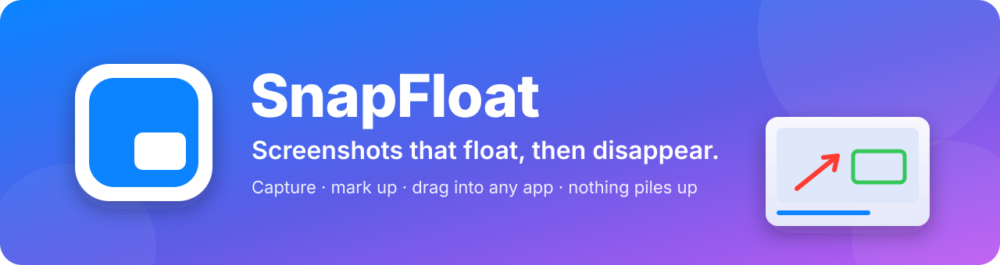

<p align="center"></p>

<p align="center">
  <a href="https://github.com/shaurya-8055/snapfloat/releases/latest"></a>
  <a href="https://github.com/shaurya-8055/snapfloat/releases"></a>
  
  <a href="LICENSE"></a>
</p>
<p align="center">
  <a href="https://github.com/shaurya-8055/snapfloat/actions/workflows/ci.yml"></a>
  
  
  
  
</p>

<h3 align="center">Capture, mark up and drag into any app. Nothing piles up unless you save it.</h3>
<p align="center">Free and open source, for Linux and Windows.</p>

Take a screenshot and a thumbnail floats in the corner of your screen. Drag it straight into WhatsApp, Slack, Discord, Gmail, ChatGPT or any other app, or just paste it. When you're done it disappears, and so does the file: your Screenshots folder only gets what you choose to save.

<p align="center"></p>
<p align="center">▶️ <a href="docs/snapfloat-demo.mp4"><b>Watch the full tour</b></a> (voiceover, 1080p, English captions) · <a href="docs/snapfloat-demo.srt">captions (.srt)</a></p>

---

## 📑 Contents
[✨ Features](#-features) · [📥 Install](#-install) · [⌨️ How to use](#%EF%B8%8F-how-to-use) · [🖍️ Markup](#%EF%B8%8F-markup) · [⚙️ Settings](#%EF%B8%8F-settings) · [🔒 Privacy](#-privacy-where-screenshots-go) · [🐧 Platform notes](#-platform-notes) · [🩺 Troubleshooting](#-troubleshooting) · [🗑️ Uninstall](#%EF%B8%8F-uninstall) · [🛠️ Build](#%EF%B8%8F-build-from-source) · [🤝 Contributing](#-contributing) · [🗺️ Roadmap](#%EF%B8%8F-roadmap)

## ✨ Features

<table>
<tr>
<td width="33%" valign="top">

### 🪟 Floating thumbnail
Slides into the corner you choose. **Drag it into any app**, or `Ctrl+V`: it's already on your clipboard. Hover pauses the countdown, a flick to the edge dismisses it.

</td>
<td width="33%" valign="top">

### 🧹 Nothing piles up
Screenshots live in a private temporary folder and **delete themselves** when you're done. Only what you *Save* lands in your Screenshots folder.

</td>
<td width="33%" valign="top">

### 🖍️ Quick markup
Click the thumbnail: arrows, boxes, pen, highlighter, multi-line text, numbered steps, spotlight, crop. **Select and move** any mark, resize with `[` `]`.

</td>
</tr>
<tr>
<td valign="top">

### 🙈 Hide private info
One click finds **emails, phone numbers, OTPs and card numbers**. Untick any you want to keep, `Enter` blurs the rest. The blur can't be undone by anyone you send it to.

</td>
<td valign="top">

### 📜 Scrolling capture
Freeze the screen, drag over the part that scrolls, scroll and press *Add*. One **tall stitched screenshot**, sticky headers once, side panels trimmed. Works at 125%, 150%, 167% scaling.

</td>
<td valign="top">

### 🎥 Screen recording
*Record screen* from the tray. The **video floats in the corner** like a screenshot: click to play, drag into a chat. Light on the CPU, even on HiDPI screens.

</td>
</tr>
<tr>
<td valign="top">

### 📌 Float on screen
Keep a screenshot **on top of your windows** as a reference while you work. Drag to move, scroll to zoom, `Ctrl`+scroll to fade.

</td>
<td valign="top">

### 🔤 Copy text (OCR)
Copy all the text in a screenshot, or drag a box over just one part. Pick the **languages** to read (e.g. English + Hindi).

</td>
<td valign="top">

### 📷 Read QR codes
Right-click → *Read QR code*: the **link or text is copied**, and the thumbnail tells you what it found.

</td>
</tr>
<tr>
<td valign="top">

### 🔍 Magnifier & colour picker
A 2× **zoom bubble** for tiny details (it never reveals what you blurred), and a **picker** that copies any pixel's hex colour.

</td>
<td valign="top">

### 🎨 Beautify & combine
*Beautify* adds a gradient background, rounded corners and a shadow. *Combine* turns several shots into one image; `Shift`+drag sends them all at once.

</td>
<td valign="top">

### ⚡ One-key capture
`PrtSc` for a region, `Shift+PrtSc` for the screen. On Windows, **click a window** to capture just that window. Delayed capture for menus.

</td>
</tr>
</table>

> [!TIP]
> Closed a thumbnail too early? **Tray → Recent** brings back any of your last 10 screenshots, ready to drag again.

More: auto-dismiss timer (or keep until closed), stacks of several shots that glide into place, smaller JPG files for faster uploads, optional auto-save, custom shortcuts, start at login, shutter sound and flash, and on Windows a thumbnail for `Win+Shift+S` captures too. No telemetry, no network connections.

> [!NOTE]
> *Copy text* and *Hide private info* use the free [Tesseract](https://github.com/tesseract-ocr/tesseract) OCR engine, and everything runs on your computer: nothing is uploaded. `install.sh` installs it on Ubuntu/Debian; on Windows use `winget install UB-Mannheim.TesseractOCR`. Without it those two options are greyed out.

## 📥 Install

### 🪟 Windows

**Installer** (recommended): download [`SnapFloat-Setup.exe`](https://github.com/shaurya-8055/snapfloat/releases/latest) and run it. No admin rights needed. It adds a Start menu entry, and *Settings → Apps* uninstalls it completely (shortcuts, autostart and settings included). A newer installer updates it in place.

**[Scoop](https://scoop.sh):**
```powershell
scoop bucket add snapfloat https://github.com/shaurya-8055/scoop-bucket
scoop install snapfloat
```
To update, quit SnapFloat from the tray first (Scoop won't replace a running app), then `scoop update snapfloat`.

**Portable:** download [`SnapFloat.exe`](https://github.com/shaurya-8055/snapfloat/releases/latest) and run it. It sits in the system tray (click `^` near the clock if you don't see it). Press `PrtSc` and select an area.

> [!WARNING]
> Windows SmartScreen may warn about an unknown publisher because SnapFloat isn't code-signed yet. Click **More info → Run anyway**, or [build it yourself](#%EF%B8%8F-build-from-source).

### 🐧 Linux: AppImage (any distro)
```sh
chmod +x SnapFloat-x86_64.AppImage && ./SnapFloat-x86_64.AppImage
```
Download it from [Releases](https://github.com/shaurya-8055/snapfloat/releases/latest). It starts at login from then on. If your system lacks FUSE, add `--appimage-extract-and-run`.

> [!IMPORTANT]
> On GNOME, **log out and back in once** after the first run (and after updating). SnapFloat's small GNOME extension, which keeps thumbnails in the corner and floating windows on top, is loaded at login.

Also install:
- **Tesseract**, for *Copy text* and *Hide private info*: `sudo apt install tesseract-ocr` / `sudo dnf install tesseract`
- **wl-clipboard**, so *Copy to clipboard* works on Wayland: `sudo apt install wl-clipboard`
- **For screen recording** on Wayland: `sudo apt install gstreamer1.0-pipewire gstreamer1.0-plugins-bad` (Windows/X11 use `ffmpeg`)

### 🟠 Ubuntu / Debian (GNOME), from source
```sh
git clone https://github.com/shaurya-8055/snapfloat
cd snapfloat
./install.sh
```
Then log out and back in once. SnapFloat registers its shortcuts in *Settings → Keyboard → Custom Shortcuts* when it starts. Run `./install.sh` again to update.

<details>
<summary><b>Other Linux desktops (KDE, XFCE, …)</b></summary>

The AppImage is the easiest way. Then bind these commands in your desktop's keyboard settings:

| Command | Suggested key |
|---|---|
| `/path/to/SnapFloat-x86_64.AppImage --region` | `PrtSc` or `Ctrl+Shift+4` |
| `/path/to/SnapFloat-x86_64.AppImage --screen` | `Shift+PrtSc` or `Ctrl+Shift+3` |

Running from source instead: see [Build from source](#%EF%B8%8F-build-from-source), then use `/path/to/.venv/bin/python -m snapfloat --region` from the repo folder.
</details>

**Requirements:** Linux with X11, or Wayland with `xdg-desktop-portal` (default on Ubuntu, Fedora and most others), or Windows 10/11. Python 3.10+ only when running from source.

## ⌨️ How to use

### Shortcuts (change them in Settings)
| Keys | Action |
|---|---|
| `PrtSc` | Capture a region |
| `Shift+PrtSc` | Capture the whole screen |
| `Ctrl+Shift+4` / `Ctrl+Shift+3` | The same, as extra shortcuts |
| Click the tray icon | Capture a region (while recording: stop) |
| `Esc` / right-click | Cancel a region selection |
| Click instead of dragging | Capture the window under the pointer (Windows; it's highlighted as you move) |

### The thumbnail
| Do this | And this happens |
|---|---|
| Drag it into an app | The screenshot is sent there, and the thumbnail goes away |
| `Shift` + drag | Sends **all** visible screenshots at once |
| `Ctrl+V` anywhere | Pastes the screenshot (it's already on your clipboard) |
| Click | Opens [markup](#%EF%B8%8F-markup) (a recording plays) |
| Flick toward the screen edge | Dismisses it (a short flick springs back) |
| Hover | Pauses the countdown |
| Click the **✕** | Closes it (still available under *Recent*) |
| Right-click | Mark up · Copy · Copy text · Read QR code · Beautify · Combine all · Open · Save · Save As · Float on screen · Keep · Close |

### Tray menu
| Item | What it does |
|---|---|
| Capture region / screen | Same as the shortcuts |
| 📜 Scrolling capture | The screen freezes: drag the part that scrolls, scroll about half its height, press *Add*, repeat, then *Done* (Windows/X11 grab automatically while you scroll). The bar tells you if a step didn't join and what to do |
| 🎥 Record screen | Starts a recording (on Wayland, pick a screen or window in GNOME's dialog). Click the tray icon or *Stop recording* to finish |
| ⏱️ Capture after… | 3, 5 or 10 second countdown, then a region capture. Click the ring to cancel |
| 🕘 Recent | The last 10 screenshots of this session. Click one to bring its thumbnail back |

### Command line
```sh
snapfloat              # start in the tray (or open Settings if it's already running)
snapfloat --region     # capture a region (starts the app if needed)
snapfloat --screen     # capture the whole screen
snapfloat --settings   # open Settings
snapfloat --quit       # quit
snapfloat --self-test  # check this install works: drawing, image formats, helper programs, OCR, QR
```

## 🖍️ Markup
Click a thumbnail to open the editor. **Done** updates the thumbnail, its file and the clipboard, so you can drag the edited version straight away.

| Tool | Key | Use it for |
|---|---|---|
| 👆 Select | `V` | Click a mark: drag to move it, `Delete` removes it, `[` `]` resize it |
| ↗️ Arrow | `A` | Point at something |
| ⬜ Box | `R` | Frame an area |
| ⭕ Ellipse | `E` | Circle something |
| ✏️ Pen | `P` | Draw freehand |
| 🖍️ Highlighter | `H` | Mark text, like a marker pen |
| 🔤 Text | `T` | Click, type, `Enter` (`Shift+Enter` for a new line, `Esc` drops it) |
| 1️⃣ Numbered steps | `N` | Click to place 1, 2, 3… badges |
| 🔍 Magnifier | `M` | Drag out from the centre of a small detail: a 2× bubble appears beside it |
| 🔦 Spotlight | `S` | Drag over what matters: everything else darkens |
| 📋 Copy text from an area | `X` | Drag a box over some text: just that text is copied |
| 🌫️ Blur | `B` | Drag over phone numbers, emails, OTPs or faces. Nothing of the original survives |
| ✂️ Crop | `C` | Drag the area to keep |
| 💧 Colour picker | `I` | Click a pixel: its colour becomes your pen colour and its hex code is copied |

Toolbar buttons: **👁 Hide private info** (finds emails, phone numbers, OTPs and card numbers; click a box to leave it visible, `Enter` blurs the rest as one undo step) and **📋 Copy text** (all of it).

`Ctrl+Z` undo · `Ctrl+Shift+Z` redo · `[` `]` smaller/bigger · `Enter` done · `Esc` cancel

## ⚙️ Settings
Open from the tray icon → **Settings…**

<p align="center"></p>

| Setting | What it does | Default |
|---|---|---|
| Show for | Seconds the thumbnail stays; `0` = until you close it | 6 s |
| Position | Which screen corner | bottom-right |
| Size | Thumbnail size | 220 px |
| Copy to clipboard | Also put every shot on the clipboard | on |
| Send smaller files | Drag a JPG (max 1920 px) instead of the full PNG | off |
| Save when it disappears | Keep a copy in the save folder after timeout | off |
| Save folder | Where *Save* puts files | `~/Pictures/Screenshots` |
| Print Screen key | `PrtSc` = region, `Shift+PrtSc` = screen. Takes those keys over from GNOME (its `Alt+PrtSc` window shot stays) or Windows' Snipping Tool; turning it off or uninstalling gives them back | on |
| Capture region / screen | Extra global shortcuts. Click the field and press keys; Backspace clears it | `Ctrl+Shift+4` / `Ctrl+Shift+3` |
| Start at login | Launch automatically, so the first shortcut after a reboot is instant | on |
| Text languages | OCR languages, joined with `+` (e.g. `eng+hin`). Add more with `sudo apt install tesseract-ocr-hin` | English |
| Shutter sound / Screen flash | (Windows/X11) Feedback when a shot is taken. On Wayland, GNOME already does both | on |
| Also catch copied images | (Windows/X11) Show a thumbnail for `Win+Shift+S`/`PrtSc` captures | off |

Settings are stored in `~/.config/snapfloat/snapfloat.conf` (Linux) or the registry under `HKCU\Software\snapfloat` (Windows).

## 🔒 Privacy: where screenshots go
- 🗂️ Screenshots are kept in a **private, owner-only temporary folder**: your session's runtime folder on Linux (`/run/user/<id>/snapfloat`, in memory and cleared at logout) or `%TEMP%\snapfloat-<user>` on Windows. They exist as files only so you can drag them into apps.
- 🕘 The last 10 stay there so *Recent* can bring them back; older ones are deleted as new ones arrive, and **all of them are deleted when SnapFloat quits**.
- 💾 Nothing goes to your Screenshots folder unless you click **Save** or turn on *Save when it disappears*.
- 🌐 SnapFloat makes **no network connections** and has no telemetry. OCR and QR reading run on your computer.
- 📝 Errors are logged to `~/.local/state/snapfloat/snapfloat.log` (Windows: `%LOCALAPPDATA%\snapfloat`) so problems can be diagnosed. The log never contains your screenshots.

## 🐧 Platform notes

<details>
<summary><b>Linux on Wayland (Ubuntu, Fedora, …)</b></summary>

Wayland is stricter than X11, which is the main reason a tool like this didn't exist before:
- **Capturing:** apps can't read the screen directly, so SnapFloat asks the desktop (via `xdg-desktop-portal`). Region capture uses GNOME's own screenshot UI; the file it saves is moved out of `~/Pictures` straight away.
- **Placement:** Wayland doesn't let apps position their windows or keep them on top. The bundled GNOME Shell extension (`snapfloat/gnome-extension/`) does that for SnapFloat's thumbnails (windows titled `snapfloat-thumb …`) and floating screenshots (`snapfloat-pin`), and stops thumbnails from taking focus from the app you're typing in. It touches no other windows. Without it, thumbnails still work but open wherever GNOME places them.
- **Shortcuts:** apps can't grab global keys, so SnapFloat registers GNOME custom shortcuts that run `snapfloat --region` / `--screen`.
- **Recording:** uses GNOME's screen-sharing dialog (the ScreenCast portal) and GStreamer, recording at the size you see, 24 fps.
</details>

<details>
<summary><b>Windows</b></summary>

- Shortcuts are real global hotkeys. If one is taken by another app, SnapFloat shows a tray message, so pick another.
- To stop Windows saving its own `Win+Shift+S` captures: Snipping Tool → Settings → turn off *Automatically save screenshots*.
- Recording uses `ffmpeg` (install it with `winget install ffmpeg` or `scoop install ffmpeg`).
</details>

## 🩺 Troubleshooting
| Problem | Fix |
|---|---|
| Thumbnail appears in the middle of the screen (GNOME) | Log out and back in once after installing. Check with `gnome-extensions info snapfloat@shaurya-8055.github.io` (should say `State: ACTIVE`, or `ENABLED` on GNOME 45) |
| Shortcut does nothing (GNOME) | Check *Settings → Keyboard → Custom Shortcuts* for "SnapFloat region". Another shortcut may use the same keys |
| Full-screen capture or scrolling capture does nothing on Wayland | GNOME needs permission for silent screenshots and can't ask a tray app. Re-run `./install.sh`, or run `gdbus call --session --dest org.freedesktop.impl.portal.PermissionStore --object-path /org/freedesktop/impl/portal/PermissionStore --method org.freedesktop.impl.portal.PermissionStore.SetPermission screenshot true screenshot snapfloat "['yes']"` |
| Scrolling capture says "Couldn't join that part" | Scroll less between *Add*s (about half the area's height), and capture something that isn't changing at the same time |
| *Record screen* is greyed out | It says what to install: `gstreamer1.0-pipewire` on Wayland, `ffmpeg` on Windows/X11 |
| No tray icon (GNOME) | Needs the AppIndicator extension (on by default on Ubuntu; on Fedora install *AppIndicator and KStatusNotifierItem Support*) |
| Drag doesn't drop into an app | Paste with `Ctrl+V` instead, and [open an issue](https://github.com/shaurya-8055/snapfloat/issues) naming the app |
| `Could not load the Qt platform plugin "xcb"` | `sudo apt install libxcb-cursor0` |
| Something else | Run `snapfloat --self-test`, and attach `~/.local/state/snapfloat/snapfloat.log` to an [issue](https://github.com/shaurya-8055/snapfloat/issues) |

## 🗑️ Uninstall
The easiest way on any system: **Settings → Uninstall…**. It removes the shortcuts, autostart entry, settings, logs, GNOME extension and temporary screenshots, then quits. Screenshots you saved are not touched, and the `PrtSc` keys go back exactly as they were.

- **Windows installer:** *Settings → Apps → SnapFloat → Uninstall*
- **Windows, Scoop:** `scoop uninstall snapfloat`
- **Windows, portable:** *Settings → Uninstall…* (or `SnapFloat.exe --uninstall`), then delete `SnapFloat.exe`
- **Linux, `install.sh`:** `snapfloat --uninstall` (or `./install.sh --uninstall`)
- **Linux, AppImage:** `./SnapFloat-x86_64.AppImage --uninstall`, then delete the file

## 🛠️ Build from source
```sh
git clone https://github.com/shaurya-8055/snapfloat && cd snapfloat
python3 -m venv .venv && . .venv/bin/activate      # Windows: .venv\Scripts\activate
pip install --ignore-requires-python -e .           # see the PySide6 note in pyproject.toml
python -m snapfloat
```

<details>
<summary><b>Windows exe, AppImage and releases</b></summary>

**Windows exe:**
```sh
pip install pyinstaller
pyinstaller --onefile --noconsole --name SnapFloat --paths . snapfloat/__main__.py   # → dist/SnapFloat.exe
```

**AppImage:** `bash packaging/build-appimage.sh` (with Python 3.12) → `dist/SnapFloat-x86_64.AppImage`

**Releases:** push a tag like `v1.2.0`. GitHub Actions builds `SnapFloat.exe`, `SnapFloat-Setup.exe` and `SnapFloat-x86_64.AppImage`, runs each one's self-test (the installer is also installed and uninstalled), and only then publishes them.
</details>

<details>
<summary><b>Project structure</b></summary>

```
snapfloat/
  __main__.py             command line; only the standard library loads until Qt is needed (fast hotkeys)
  system.py               paths, the running-instance socket, uninstall (standard library only)
  common.py               settings, constants, theme, clipboard
  app.py                  the tray app: capture flow, thumbnails, Recent, --self-test
  capture.py              screenshots: desktop portal (Wayland), region/window selector (Windows/X11)
  scroll.py               scrolling capture: matching and stitching the frames
  record.py               screen recording (ScreenCast portal + GStreamer, or ffmpeg)
  thumb.py                the floating thumbnail; Float on screen
  editor.py, draw.py      the markup editor; drawing and hit-testing the marks
  ocr.py, effects.py      Tesseract text, private-info detection, QR codes; Beautify and Combine
  hotkeys.py              global shortcuts, GNOME keybindings and extension, autostart
  settings.py             the Settings window
  gnome-extension/        GNOME Shell extension: corner placement, keeping windows on top, focus handling
pyproject.toml            package metadata and dependencies
install.sh                Linux installer / updater / uninstaller
packaging/                icon, desktop entry, AppImage build script, Windows installer script
test_snapfloat.py         smoke test (runs without a display)
.github/workflows/        CI on every push; on a version tag, builds and smoke-tests the exe, installer and AppImage
```
</details>

## 🤝 Contributing
Contributions are welcome: bug reports, fixes, and features from the roadmap.

**Reporting a bug:** open an [issue](https://github.com/shaurya-8055/snapfloat/issues) with your OS and version, desktop (GNOME/KDE), session type (`echo $XDG_SESSION_TYPE`), what happened, and the log file (`~/.local/state/snapfloat/snapfloat.log`).

**Making a change:**
1. Fork, then create a branch: `git checkout -b fix-something`
2. Set up a dev environment as in [Build from source](#%EF%B8%8F-build-from-source)
3. Run the smoke test: `python test_snapfloat.py` (it must print `ok`)
4. If you touched the GNOME extension: `node --input-type=module --check < snapfloat/gnome-extension/extension.js`
5. Test it for real on your platform, and say in the PR what you tested on
6. Open a pull request with a short description of the why

**Code style:** a few focused modules and few dependencies (PySide6; zxing-cpp and jeepney are optional); PEP 8 with ~120-character lines and short comments that explain *why*; everything must keep working on Windows, X11 and Wayland; UI work must stay smooth.

## 🗺️ Roadmap
- [x] Floating thumbnail, drag & drop, Recent, delayed capture, flick to dismiss
- [x] Markup with blur, numbered steps, spotlight, magnifier, colour picker, select & move
- [x] Copy text (OCR) in your languages, one-click hide private info, read QR codes
- [x] Scrolling capture, screen recording, float on screen
- [x] One-key `PrtSc` capture; window capture on Windows
- [x] AppImage, Windows installer, Scoop
- [ ] winget: submitted, in review ([microsoft/winget-pkgs#455524](https://github.com/microsoft/winget-pkgs/pull/455524))
- [ ] GNOME extension on extensions.gnome.org: submitted, in review ([SnapFloat](https://extensions.gnome.org/extension/11361/snapfloat/))
- [ ] KDE Plasma: corner placement via a KWin script

## 📄 License
[MIT](LICENSE): free to use, modify and share.

<p align="center"><sub>Made by <a href="https://github.com/shaurya-8055">Shaurya Shakya</a> · if SnapFloat saves you time, a ⭐ helps others find it</sub></p>
